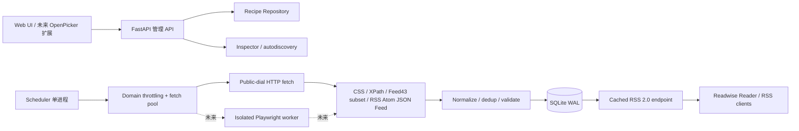

# OpenFeed Studio — 体系架构与技术决策（ADR）

**决策：模块化单体优先，必要时独立浏览器 Worker，不启动时就拆分微服务。** 



## ADR-001：Python/FastAPI，而非立即迁移 TypeScript

现有 v0.1 有工作的 Python 代码、SQLite 数据和真实 15 项端到端测试。没有经过性能和兼容性证据就将其整个重写为 Next.js/Crawlee 会损失已验证价值。**v0.2 保留 FastAPI 单体，前端静态 HTML/CSS/JS；未来只有在可视化编辑器或浏览器抓取确实需要时才引入 TypeScript SDK 或独立 Node worker。** 技术优先级是可靠性和可迁移性，不是技术栈数量。

## ADR-002：抓取与发布隔离

HTTP `/rss/{id}.xml` 只读取 SQLite，绝不在请求时同步抓取来源。数据库保存最后一次成功提取的条目；失败记录 `FetchRun` 与连续失败次数，但不会删除旧数据。返回 RSS 2.0、ETag、缓存头；订阅 URL 的 Feed ID 可以用 Bundle v2 恢复。**注意：Bundle 不含条目历史，完整恢复要备份 SQLite。**

## ADR-003：状态机与排队

`new → healthy → error → healthy`，`enabled=false` 表示暂停而非数据删除。调度循环每 30 秒检查 `next_run`，单实例最多 4 条并发 Fetch；域名请求最小间隔按主机名限速。多个同域名到期时，未取得许可的任务必须持久化 `next_run` 顺延，防止相同域名 Feed 饥饿。失败指数退避按**连续**失败计算，成功时归零。

目前仍是**单 Uvicorn worker 语义**：进程内锁和域名节流不支持多副本一致性；未来使用 Postgres + 数据库领取租约/队列（`FOR UPDATE SKIP LOCKED` 或任务队列），配置独立 worker 后才扩容。

## ADR-004：Recipe Schema / 接口

当前 Recipe v0.2：

```json
{
  "mode": "css",
  "item_selector": "article.memo",
  "fields": {
    "title": "h2",
    "link": "a@href",
    "date": "time@datetime",
    "summary": "p"
  }
}
```

`mode` = `css` / `xpath` / `pattern`。pattern 采用 Feed43 风格 `{%}` 捕获、`{*}` 跳过；字段值对应捕获组序号字符串，如 `"title":"2"`。v0.2 是精简兼容，不是 Feed43 全兼容实现。

- `POST /api/inspect`：获取目标页并输出候选、文章预览和被净化的静态快照。
- `GET/POST /api/feeds`：源管理；`PATCH /api/feeds/{id}` 更新或停启；`POST /api/feeds/{id}/run` 手动抓取。
- `GET /api/feeds/{id}`：源、最近文章、最近抓取诊断。
- `GET /rss/{id}.xml`：无需管理员令牌的**公开** RSS 输出。
- `GET /api/export/recipes`：v2 Bundle，包含源 ID；`POST /api/import/recipes` 支持 v1/v2。
- `GET /api/export/opml` / `POST /api/import/opml`：订阅源 URL 导入导出（不是规则备份）。
- `GET /api/status`：管理概览与公开 Feed Base URL。

下一次 Schema 演进应引入 `recipeVersion`, `fetchStrategy`, `pagination`, `selectors`, `normalizers`, `access`, `schedule`, `itemType`, `qualityGate`；通过迁移器升级而非静默重新解释旧 Recipe。必须保存提取引擎版本，避免依赖升级让既有规则失效。

## ADR-005：动态网页方案

不强行将 Playwright 装入当前轻量 Docker 主容器。二期优先搭建受网络限制、文件系统隔离的浏览器 Worker；使用明确的任务协议（来源 URL、有限动作 DSL、选择器、超时、返回已净化 HTML/JSON）；严禁把任意 JS 字符串或 Python 代码当成 Recipe 可执行指令。网站安全验证与权限不得绕过。

## ADR-006：原生 Feed、第三方适配器

优先官方 RSS/Atom/JSON Feed；其次 RSSHub/RSS-Bridge 已有站点路由；然后 html2rss 自动识别或者本地 CSS/XPath；最后动态浏览器。RSSHub/Bridge 等建议通过外部标准 RSS URL 消费，**不要将 AGPL 代码直接复制到主程序**。引入任何 adapter 需要可控超时、缓存、来源可追溯、许可证复核和故障隔离。

## ADR-007：运维容量预算与观测

假设 200 个源每 2 小时抓取一次：**2,400 次来源检查/天**（不是当前承诺）；并发按域名独立限流。静态 0.2–2 秒/次和浏览器 5–20 秒/次的区间是容量规划示例、非测量数据。优先观测 P50/P95 fetch latency、单次解析 CPU、成功率、零条目占比、提取项目波动、Feed age、数据库增长、域名 429/403 比例和漏报/误报。

成本公式：月总抓取次数 = `Σ (30×24×60/interval_minutes)`；动态浏览器成本 = 次数 × 页面运行秒数。Cloudflare 免费 Workers 的请求数不是浏览器计算时间；不能只凭 100,000 请求额度断言免费可处理 200 个 JS 站点。

## ADR-008：备份与发布

备份 SQLite 应在同一连接上用 SQLite Backup API（保留 WAL 一致性）；每天至少异地备份 `db.sqlite3` 与 v2 Recipe Bundle；恢复演练要核对 Feed ID、条目数、最新 `published_at`、Reader URL 以及配置中的公共域名。新部署不要擅自暴露管理员 API；反向代理 HTTPS + 身份/访问控制后方可供公网使用。

## v0.3 ADR 增补（2026-10-21）

### ADR-005：分层的可视化规则生成

- 自动静态识别：提取候选兄弟文章容器，按文章标题结构、时间标签、重复数及主内容位置评分；拒绝典型导航菜单，返回可验证的选择器建议和匹配数。
- 手工点选：`static/picker.js` 在完全净化的静态 HTML `srcdoc` 中工作，选取文章容器再对字段做**相对于文章容器**的选择器推导，实时反馈有多少个文章容器匹配该字段。它并不能直接操作目标站点的跨域 DOM；这是产品设计的刻意边界。
- 提取执行：`openfeed/extract.py` 作为唯一规则求值入口。JS 和后端不会各自定义不同语义的“抓取规则”；最终保存和二次抓取依后端解析结果为准。
- 规则质量：返回不可靠日期、原生 RSS 可替代、一次提取超 100 条等警告，禁止把正常 HTTP 200 等同于内容提取成功。

### ADR-006：实验性浏览器模式

`Recipe` 增加 `fetch_mode = http | browser` 及 `wait_selector`。默认 `http`；`browser` 只有显式设置 `OPENFEED_EXPERIMENTAL_BROWSER=1` 才可以执行。浏览器获取代码位于 `openfeed/browser.py`，与普通 HTTP 获取路径分离。默认 Docker 镜像**不安装** Chromium。

生产设计仍要求**独立容器/主机的浏览器 Worker + 操作系统级出站网络隔离**。不能把 Python 侧 DNS 预检查或 Playwright 的路由拦截当作彻底的 SSRF 防护。动态模式没有经外部网站联通实测，不能视作已完成生产验收。

### ADR-007：规则备份与完整数据备份分开

- Recipe Bundle v2：规则、源 URL、永久 ID、暂停状态；支持事务式原子批量导入，但不包括历史文章。
- SQLite 在线备份：受管理员鉴权的 `/api/export/database`，使用 SQLite Backup API 获取一致性快照；包含所有 Feed 历史、抓取日志与 ID。下载后按敏感数据存储。
- OPML：对订阅客户端暴露标准 Feed URL，但**不能**恢复规则。

### ADR-008：保留单进程调度边界

当前持久化 `next_run` 与 SQLite WAL 满足单机个人部署，但进程内锁、同域名节流不支持多实例。升级路线应从 Redis/PostgreSQL 领取租约、共享速率限制、可观测队列开始，不应先引入微服务。

## v0.3 验收证据

- `python -m pytest -q`：40 项通过（Chromium 在执行环境可用）。
- Playwright/Chromium：真实网页元素点击、重复卡片规则选择、UI 到实际 FastAPI ASGI / SQLite / RSS 的应用级离线联调。
- 动态 JS：用本地 HTML/JavaScript 生成研究条目，浏览器渲染后可提取；**不是外部网站抓取验证**。
- Docker、真实金融站点、Reader 真实在线拉取仍未验收；参见 `RELEASE_V03.zh-CN.md`。

## v0.4 新增 ADR：分页、可回滚规则、并发版本栅栏

### ADR-009：显式有限分页而不是开放式爬虫

Recipe 新增 `next_selector: string` 和 `max_pages: int (1..3)`，不提供任意链接遍历、JS 任意操作或跨域分页。每轮最多 3 次页面请求，页面间默认等待 2 秒；只跟随与第一页实际有效 URL 完全同源（协议、主机名、端口）的 `href`，逐次走原先绑定安全 DNS 的 HTTP 客户端。检测访问循环，并以原文 URL 跨页去重。**采集任意一页失败，整个刷新失败，不写入部分结果。** 原 Feed 输出保留最后的成功历史。

### ADR-010：配置版本持久化

新增 `feed_revisions(feed_id, revision, changed_at, action, snapshot)`。新增/导入/修改/恢复每次均产生完整快照，保留最近 40 条。恢复旧版不是覆写历史，而是生成一个新修订记录。因来源 URL 改变会污染历史，存有文章后禁止恢复与当前来源不同的 URL。OPML 仍只保存订阅链接，完整历史必须使用 SQLite 在线备份。

### ADR-011：版本栅栏拒绝旧规则结果

在 `GET feed` 时读取同一 SQL 快照内的 `recipe_revision`。异步 fetch 可以耗时，此时管理员可能修改规则。`Store.finish` 在 `BEGIN IMMEDIATE` 事务中核对当时版本；如不一致，返回 `stale`，**不写文章、不写成功/错误状态、不覆盖新配置的到期调度**。前端提示可立即按新规则再次抓取。这样避免一个过时规则把未验证的文章写进更新后的 Feed。

### ADR-012：调度关闭先于数据库关闭

追踪 Scheduler 创建的任务，关闭应用时停止领取新任务，然后等待正在运行的任务有限时间，超时取消，最后再关闭 SQLite。仍明确限定单个进程：任何多实例化都需要数据库租约和共享域名限制，不能直接复制多个应用实例对同一数据库运行。
